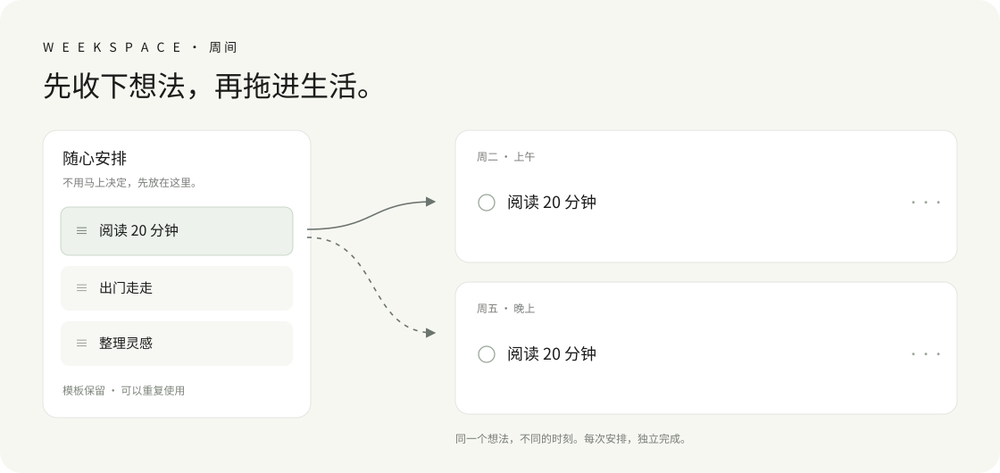

# Weekspace · 周间

**把想做的事先收好，再拖进合适的时间。**

一个极简的原生 macOS 计划工具。核心是「随心安排」：任务先进入右侧任务池，再拖到任意一天的上午、下午或晚上。**同一条任务可以重复拖放，每次生成独立、可勾选的安排。**



## 随心安排，是主角

1. **随手写**：想读书、运动、整理笔记，先记到任务池，不必立即决定时间。
2. **拖进去**：把任务拖进七日视图中的任意格子。
3. **重复用**：原任务继续留在池里，可以再拖到另一天；每个实例独立完成。
4. **随时改**：任务可拖动调整，标题直接编辑；模板点 × 删除，也可撤销。

例如，把「阅读 20 分钟」分别拖到周二上午和周五晚上。勾选周二的任务，只完成这一次，周五的安排和任务池模板继续保留。

## 其余功能

- **任意连续七天**：双指横滑、拖动日期栏或点箭头平移日期；「本周」回到周一至周日。日期平时是静态文字，点击才展开日历。
- **格内直接输入**：点添加就在原位填写，回车保存；需要时间和备注时再打开详情。
- **固定课表**：每周、单双周、指定教学周和部分特殊周次；时间使用小时／分钟选择器。
- **课表导入**：在本机解析 `.xlsx`、CSV 和 TSV，合并连续节次，预览并修正后再导入；复杂布局可用 AI 辅助识别。
- **AI 工作台**：手写记录、七日复盘、工作汇报、排程建议、目标拆解与负荷分析。总结严格对应所选七天，排程建议确认后才加入。
- **每日哲思**：联网获取一句哲学类文字，显示作者与来源；带缓存和离线精选。
- **独立桌面视图**：显示每日安排，支持勾选与快速添加；可贴在桌面或置顶。
- **本地保存与归档**：编辑自动保存，跨天自动归档，支持历史快照、JSON 备份及七日 Markdown 导出。

## 获取与构建

面向 macOS 14 及以上。开发和运行验证使用 Apple Silicon Mac；Intel 可从源码尝试构建，尚未做运行验证。

下载包可在 [Releases](https://github.com/gufanyuanying031/weekspace/releases) 找到。开发版本使用本机临时签名，未做 Apple 公证。

源码构建需要 Xcode Command Line Tools（或 Xcode）。应用无需第三方 Swift 包：

```bash
git clone https://github.com/gufanyuanying031/weekspace.git
cd weekspace
bash scripts/build.sh
open build/周间.app
```

完整验证额外需要 Python 3，仅使用标准库：

```bash
bash scripts/verify.sh
```

测试使用合成课表、临时数据库和本机模拟 API，不读取个人课表，也不请求真实模型服务。

## 接入 DeepSeek 或其他模型

设置中可一键填入 DeepSeek 配置，填写你自己的 API Key 即可。也支持兼容 Chat Completions 的接口，包括本地服务。

AI 功能由你手动发送；可预览发送内容。任务与课表在本机解析，点击 AI 辅助识别后才会把预览文本发送给配置的服务。

当前开发版本把 API Key 保存在独立本地文件中，目录权限 `700`、文件权限 `600`，不使用钥匙串，也不进入计划导出。**密钥文件未加密，依靠本机文件权限保护。**

## 当前边界

- 桌面视图是独立原生面板，尚未提供系统「添加小组件」中的 WidgetKit 扩展。
- 课表布局和校历各不相同，必须核对学期第 1 周、特殊周次和上课时间。旧 `.xls` 需先另存为 `.xlsx`。
- 不支持所有复杂校历、加密工作簿、图片 OCR、云同步或系统提醒。
- AI 结果是可编辑的草稿；不会自动改动既有任务。
- 联网句子来自第三方句库，作者与出处尚未逐句考证。

更多说明见 [使用指南](docs/guide.md) 和 [隐私说明](docs/privacy.md)。欢迎提交 Issue 或 Pull Request。

## 许可证与来源

代码使用 [MIT License](LICENSE)。图标和示意图为本项目原创。

每日句子通过[一言公开接口](https://developer.hitokoto.cn/sentence/)获取，文字的版权及署名以其来源为准，不属于本项目代码许可证的授权范围。课表导入流程参考了 [CourseSchedule 的公开导入说明](https://github.com/cakeni/CourseSchedule/blob/main/docs/IMPORTING.md)，解析代码由本项目独立编写。
